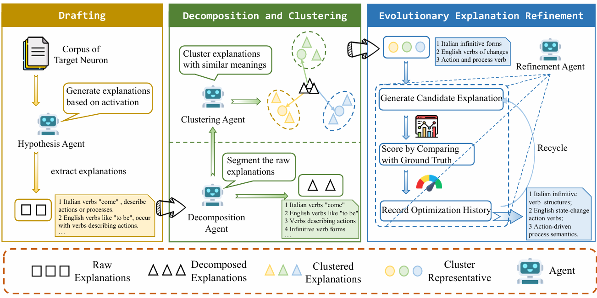
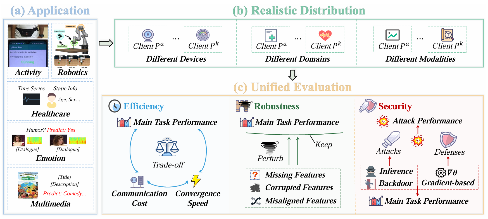

<html lang="en">
  <head>
  <title>Michael Liu</title>
  <meta content="text/html; charset=utf-8" http-equiv="Content-Type">
  <meta name="viewport" content="width=device-width, initial-scale=1">
  
  <link rel="preconnect" href="https://fonts.googleapis.com">
  <link rel="preconnect" href="https://fonts.gstatic.com" crossorigin>
  <link href="https://fonts.googleapis.com/css2?family=Crimson+Pro:ital,wght@0,400;0,500;0,600;0,700;1,400&display=swap" rel="stylesheet">
  <link rel="stylesheet" href="https://cdnjs.cloudflare.com/ajax/libs/font-awesome/6.4.0/css/all.min.css">

  
  </head>

<body>

<header class="site-header">
  

    <h1 class="header-name">Michael Liu</h1>
    
  

  <nav class="site-links" aria-label="Links">
        <a href="https://bv003me.vercel.app/" target="_blank" rel="noopener">Writing</a>
        <a href="/sites/">Websites</a>
        <a href="mailto:michaelliuwq003@gmail.com">Email</a>
        <a href="https://x.com/bbz377889285007" target="_blank" rel="noopener">X</a>
        <a href="https://michaelliu899840.substack.com/" target="_blank" rel="noopener">Substack</a>
        <a href="https://github.com/BV003" target="_blank" rel="noopener">GitHub</a>
        <a href="https://www.linkedin.com/in/michael-liu-0673452b1/" target="_blank" rel="noopener">LinkedIn</a>
        <a href="https://scholar.google.com/citations?user=SYCjc44AAAAJ&hl=en&oi=sra" target="_blank" rel="noopener">Scholar</a>
        <a href="/files/cv.pdf" target="_blank" rel="noopener">CV</a>
  </nav>

  
</header>

<main>

<section class="section">
  <h2 class="section-title">
    About Me
  </h2>

Hi.
 
I'm Weiqi Liu, and you can call me Michael.
 
I'm an engineer who builds software and AI systems. I'm also interested in investing, cryptocurrency, literary writing, and aesthetics.

If you'd like to talk, whether it's about something fun, something technical, or something about money, please drop me an <a href="mailto:michaelliuwq003@gmail.com" class="inline-link">e-mail</a>. I'd be glad to hear from you.

</section>

<section class="section">
  <h2 class="section-title">
    News
  </h2>

  

    [2026.08]
    

      I will begin my M.S. in Electrical and Computer Engineering at University of Washington, Seattle this fall.
    

  

  

    [2026.06]
    

      Graduated from Wuhan University.
    

  

  

    [2026.01]
    

      I am excited to begin my role as an AI Software Engineer Intern at Apple.
    

  

  

    [2026.01]
    

      One paper related to AI interpretability is now available on arXiv. Feel free to check it out.
    

  

  

    [2025.09]
    

      One paper is accepted to NeurIPS 2025(Spotlight). Thanks to all my collaborators.
    

  

  

</section>

<section class="section">
  <h2 class="section-title">
    Work Experience
  </h2>

  

    

      

        Apple
        Jan 2026 – Jul 2026
      

      
AI Software Engineer Intern

    

  

  

</section>

<section class="section">
  <h2 class="section-title">
    Projects
  </h2>

  

    

      

        MemServe
        <a href="https://github.com/PhysFlow/ServerlessLLMonSuperchips" class="pub-link project-link" target="_blank">
          Code
        </a>
      

      
Serving models larger than MIG memory on NVIDIA MIG instances with SGLang.

      <ul class="project-points">
        <li>HybridGEMM kernel that computes on weights kept in CPU memory.</li>
        <li>Runtime that tunes the split ratio alpha online from HBM and host-link load.</li>
        <li>Serverless control plane that places models on SGLang workers on demand.</li>
      </ul>
    

  

  

</section>

<section class="section">
  <h2 class="section-title">
    Academic Publications
  </h2>

  

  

    <!-- Publication 1 -->
    

      <!--
      

        
      

      -->
      

        
NeuronScope: A Multi-Agent Framework for Explaining Polysemantic Neurons in Language Models

        
Weiqi Liu, Yongliang Miao, Haiyan Zhao, Yanguang Liu, Mengnan Du

        

          
arXiv, 2026

          

            <a href="https://arxiv.org/pdf/2601.03671" class="pub-link" target="_blank">
              Paper
            </a>
          

        

      

    

    <!-- Publication 2 -->
    

      <!--
      

        
      

      -->
      

        
MARS-VFL: A Unified Benchmark for Vertical Federated Learning with Realistic Evaluation

        
Wei Shen, Weiqi Liu, Mingde Chen, Wenke Huang, Mang Ye

        

          
NeurIPS, 2025 (Spotlight)

          

            <a href="https://neurips.cc/virtual/2025/poster/121843" class="pub-link" target="_blank">
              Paper
            </a>
            <a href="https://github.com/shentt67/MARS-VFL" class="pub-link" target="_blank">
              Code
            </a>
          

        

      

    

  

</section>

<!-- ## Popular Publications -->

<section class="section">

<h2 class="section-title">
  Education
</h2>

  

    

      

        University of Washington, Seattle
        2026 – Present
      

      
M.S. in Electrical and Computer Engineering

    

  

  

    

      

        Wuhan University
        2022 – 2026
      

      
B.S. in Software Engineering

    

  

</section>

<section class="section">
  <h2 class="section-title">
    Service
  </h2>

  

    

      

        Reviewer
        2025
      

      
Applied AI Letters

    

    

      

        Teaching Assistant
        Fall 2023
      

      
Advanced Programming, Wuhan University

    

  

  

</section>

</main>

</body>
</html>
